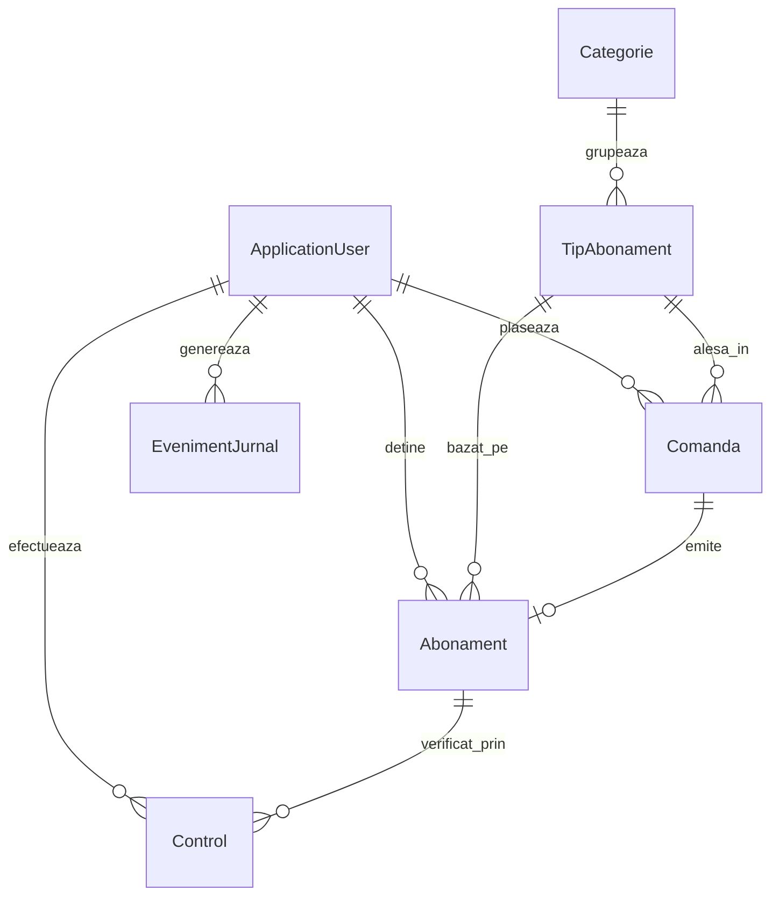

# TransAbon

**TransAbon – Sistemul de gestionare a abonamentelor de transport.** Aplicație Web (ASP.NET Core MVC) prin care clienții comandă online abonamente de transport interurban, controlorii verifică valabilitatea lor prin codul unic, iar administratorul gestionează catalogul, conturile și rapoartele.

Proiect realizat în baza caietului de sarcini (versiunea 1.0, Colegiul Universității Tehnice a Moldovei, 2026). Beneficiar: Iurcu Nicolae, operator de transport interurban.

## Cuprins

1. [Specificații](#1-specificații)
2. [Tehnologii](#2-tehnologii)
3. [Pornire rapidă](#3-pornire-rapidă)
4. [Structura proiectului](#4-structura-proiectului)
5. [Baza de date](#5-baza-de-date)
6. [Configurare](#6-configurare)
7. [Starea funcționalităților](#7-starea-funcționalităților)
8. [Funcționalități principale implementate](#8-funcționalități-principale-implementate)
9. [Lucrul în echipă](#9-lucrul-în-echipă)
10. [Probleme frecvente](#10-probleme-frecvente)

---

## 1. Specificații

### Roluri

| Rol | Ce poate face | Pagina de start |
| --- | --- | --- |
| Vizitator | Consultă catalogul public, trimite feedback | `/` |
| Client | Își creează cont, comandă abonamente, își vede istoricul, anulează înainte de start | `/cont` |
| Controlor | Introduce codul unui abonament și primește rezultatul: valid, expirat, anulat sau cod inexistent | `/validare` |
| Administrator | Gestionează tipurile de abonament și tarifele, conturile, jurnalul și rapoartele | `/admin` |

Un abonament nu este legat de un traseu, ci de o **perioadă de valabilitate** (1, 3 sau 6 luni) și de o **categorie** de călători (General, Elev, Student etc.). Este valabil pe toate mijloacele de transport din regiune, deci controlorul verifică un singur lucru: dacă abonamentul este activ la momentul controlului.

### Ce include această etapă

Comandă online, gestiunea contului, validare, administrare, rapoarte.

### Ce nu include această etapă

- plata online cu cardul (decontarea se face în afara aplicației);
- aplicație mobilă separată;
- scanarea codului QR (codul se introduce manual);
- migrarea automată a istoricului vechi de abonamente.

### Reguli importante din caietul de sarcini

- Parolele se păstrează doar sub formă de hash; comunicarea se face prin HTTPS.
- Fiecare pagină și acțiune este restricționată pe server în funcție de rol.
- Datele personale ale clienților nu apar în catalogul public.
- Interfața respectă WCAG 2.1 nivel AA (contrast, navigare de la tastatură, etichete la formulare).
- Cerințele sunt marcate M (obligatorie), R (recomandată), O (opțională).

## 2. Tehnologii

| Componentă | Tehnologie |
| --- | --- |
| Platformă | .NET 10, ASP.NET Core MVC (Razor views) |
| Limbaj | C# (nullable activat) |
| Bază de date | SQLite (fișier local) |
| Acces la date | Entity Framework Core 10 cu migrări |
| Autentificare și roluri | ASP.NET Core Identity (cookie, blocare cont după 5 încercări greșite) |
| Front-end | HTML, CSS simplu (`wwwroot/styles/`), jQuery Validation pentru formulare |
| Unelte | `dotnet-ef` (instalat local în repo, vezi `.config/dotnet-tools.json`) |

SQLite a fost ales pentru simplitate: nu cere server de baze de date, iar fiecare dezvoltator pornește proiectul cu o singură comandă. Caietul de sarcini permite o alternativă la SQL Server, cu justificare tehnică. Pentru producție se schimbă doar pachetul (`UseSqlServer`) și connection string-ul, restul codului rămâne la fel.

## 3. Pornire rapidă

### Cerințe

- [.NET 10 SDK](https://dotnet.microsoft.com/download)
- Git
- Un IDE (Rider, Visual Studio sau VS Code)

### Pași

```bash
git clone <adresa-repository-ului>
cd <folderul-proiectului>

dotnet tool restore                  # instalează dotnet-ef (o singură dată)
dotnet restore
dotnet ef database update            # creează baza de date locală
dotnet run --launch-profile https
```

Aplicația pornește la https://localhost:7081 (sau http://localhost:5250).

La pornire, aplicația aplică automat migrările și încarcă datele inițiale, deci `dotnet ef database update` este necesar doar dacă vrei să creezi baza înainte de prima rulare. **După fiecare `git pull`** rulează din nou `dotnet ef database update`, pentru că un coleg poate să fi schimbat modelul de date.

### Conturi de test (doar în Development)

| Rol | E-mail | Parolă |
| --- | --- | --- |
| Administrator | `admin@transabon.md` | `Demo123!` |
| Controlor | `controlor@transabon.md` | `Demo123!` |
| Client | `client@transabon.md` | `Demo123!` |

Conturile sunt definite în `appsettings.Development.json`. Același seed încarcă și datele demo: catalogul de abonamente, trei abonamente ale clientului (expirat, activ, programat) și trei controale (coduri `TA-DEMO-0002`, `TA-DEMO-0004`, `TA-DEMO-0005`).

### Imagini care trebuie copiate manual

- `wwwroot/images/`: `dropdown.png`, `loggin.png`, `previous.png`, `next.png`
- `wwwroot/carousel-images/`: imaginile caruselului (jpg, jpeg, png, gif, webp). Se încarcă automat, în ordine alfabetică. Dacă folderul e gol, caruselul nu se afișează.

## 4. Structura proiectului

```
Controllers/     Controllere MVC (Home, Account, Dashboard, Abonamente, Feedback, Validare, AdminUtilizatori, AdminJurnal, AdminRapoarte)
Data/            AppDbContext, DbSeeder
Migrations/      Migrările EF Core (generate, se comit în Git)
Models/          Entități, enum-uri, ViewModel-uri, opțiuni de configurare
Services/        Logica reutilizabilă (carusel, claims pentru Identity, JurnalService, ValidareService)
Views/           Pagini Razor organizate pe controller; Shared/ pentru layout și componente
wwwroot/         Fișiere statice: styles/, images/, carousel-images/, lib/
App_Data/        Baza de date SQLite locală (ignorată de Git)
docs/            Documentația echipei (lista sarcinilor)
.github/         Șabloane pentru issue-uri și pull request-uri
```

Numele proiectului, `WebApplication5`, este istoric. Namespace-ul este `TransAbon`. Nu redenumi proiectul fără acordul echipei, pentru că ar afecta configurările locale din IDE.

## 5. Baza de date

### Modelul de date



| Entitate | Rol | Câmpuri principale |
| --- | --- | --- |
| `ApplicationUser` | Cont de sistem (client, controlor, administrator) | Nume, Prenume, Activ, DataInregistrarii, CodLegitimatie (doar controlori) |
| `Categorie` | Categorie de călători | Nume, Descriere, Activ |
| `TipAbonament` | Șablon comercial: categorie + durată + preț | CategorieId, DurataLuni (1/3/6), Pret (lei, 0 = gratuit), Activ |
| `Comanda` | Solicitarea clientului | ClientId, TipAbonamentId, DataComenzii, DataInceput, Stare |
| `Abonament` | Dreptul de a călători | Cod (unic), DataInceput, DataExpirare, Stare, MotivAnulare |
| `Control` | O verificare făcută de controlor | ControlorId, AbonamentId (nul dacă nu există), CodIntrodus, DataOra, Rezultat, Cursa |
| `EvenimentJurnal` | Jurnal de audit | DataOra, UtilizatorId (nul permis), Actiune, Obiect |
| `Feedback` | Mesaj din formularul public | Nume, Email, Evaluare (1–5), Mesaj, DataTrimiterii |

Detalii de care trebuie ținut cont:

- Starea **programat** a unui abonament nu se memorează: se deduce din `DataInceput > azi`. La fel, un abonament cu `DataExpirare` trecută este expirat chiar dacă `Stare` nu a fost actualizată. Verificarea corectă se face după date.
- `DataExpirare = DataInceput + durata în luni − 1 zi` (început 2026-09-23, 1 lună → expiră 2026-10-22).
- Relațiile folosesc `Restrict` (nu se șterge în cascadă). Un client sau un tip de abonament cu istoric se **dezactivează**, nu se șterge.

### Migrări EF Core

Schema bazei de date se versionează în folderul `Migrations/`. Fișierul `.db` **nu** se comite în Git: fiecare dezvoltator își creează propria bază din migrări, iar datele de test vin din `DbSeeder`.

| Situație | Comandă |
| --- | --- |
| Ai făcut `git pull` | `dotnet ef database update` |
| Ai schimbat o entitate sau `AppDbContext` | `dotnet ef migrations add NumeSugestiv` apoi `dotnet ef database update` |
| Vrei baza de la zero | șterge `App_Data/transabon.db*`, apoi `dotnet ef database update` |

Reguli de colaborare pentru migrări sunt în [CONTRIBUTING.md](CONTRIBUTING.md).

> **Pentru mentenanța proiectului (o singură dată):** repository-ul trebuie să conțină migrarea inițială. Dacă folderul `Migrations/` lipsește, rulează `dotnet ef migrations add InitialCreate` și comite rezultatul.

### Date inițiale (seed)

`DbSeeder` rulează la fiecare pornire și este idempotent:

1. Creează rolurile `Client`, `Controlor`, `Administrator`.
2. Creează conturile din `SeedUsers` (dacă există în configurare).
3. Încarcă categoriile și tipurile de abonament din `AbonamenteData`, doar dacă tabelele sunt goale.
4. Doar în Development: abonamente și controale demo pentru contul de client.

## 6. Configurare

| Fișier | Conținut |
| --- | --- |
| `appsettings.json` | `AppInfo` (autor, versiune, grupă afișate în footer), `ConnectionStrings:Default` |
| `appsettings.Development.json` | Conturile de test (`SeedUsers`), doar pentru dezvoltare |

În producție, conturile inițiale **nu** se păstrează în fișiere din repository. Se setează prin variabile de mediu sau user-secrets:

```bash
dotnet user-secrets init
dotnet user-secrets set "SeedUsers:Administrator:Email" "admin@exemplu.md"
dotnet user-secrets set "SeedUsers:Administrator:Parola" "<parola-puternică>"
```

Nu comite niciodată parole, chei sau fișiere `.db` reale.

## 7. Starea funcționalităților

| Rută | Pagină | Stare |
| --- | --- | --- |
| `/` | Acasă (carusel, categorii, pași de comandă) | Funcțională (tarife din `AbonamenteData`) |
| `/despre` | Despre | Funcțională |
| `/abonamente` | Catalog și tarife | Funcțională (tarife din `AbonamenteData`) |
| `/contact` | Contact | Funcțională |
| `/feedback` | Formular feedback | Validează datele, **nu le salvează** |
| `/autentificare`, `/inregistrare`, `/deconectare` | Autentificare, creare cont | Funcțională (Identity) |
| `/acces-interzis` | Acces refuzat | Funcțională |
| `/cont` | Contul clientului (comandă, istoric și anulare) | Funcțională |
| `/validare` | Validare abonamente | Funcțională |
| `/admin` | Administrare (indicatori reali) | Funcțională |
| `/admin/utilizatori` | Administrare conturi și controlori | Funcțională |
| `/admin/jurnal` | Jurnal de evenimente (audit) | Funcțională |
| `/admin/rapoarte` | Rapoarte și export CSV | Funcțională |

Paginile marcate „machetă” sunt înlocuite de sarcinile din [docs/sarcini.md](docs/sarcini.md).

## 8. Funcționalități principale implementate

### 8.1. Validarea abonamentelor de către controlor (`/validare`)

Modulul este accesibil utilizatorilor cu rolul `Controlor` și permite verificarea operativă a abonamentelor fără a solicita informații despre traseu.

* **Flux de verificare:**
  1. Controlorul introduce codul abonamentului (`TA-XXXXXXXX`).
  2. Sistemul normalizează codul (elimină spațiile marginale și ignoră diferențele între majuscule și minuscule).
  3. Starea de valabilitate se deduce dinamic în funcție de data curentă (`DateTime.UtcNow`):
     * **VALID**: Abonamentul este în stare `Activ`, iar data curentă se află în intervalul `[DataInceput, DataExpirare]`. Se afișează categoria și durata.
     * **EXPIRAT**: Starea este `Expirat` sau data curentă depășește `DataExpirare`.
     * **PROGRAMAT (NEÎNCEPUT)**: Abonamentul este în stare `Activ`, dar data de început este în viitor (`DataInceput > azi`).
     * **ANULAT**: Abonamentul a fost anulat (`Stare == Anulat`).
     * **COD INEXISTENT**: Codul nu a fost găsit în baza de date.
* **Audit și istoric:**
  * Fiecare verificare generează o înregistrare în tabela `Controale` (inclusiv pentru coduri inexistente).
  * Verificarea este logată în jurnalul de audit prin `IJurnalService`.
  * Pagina afișează istoricul validărilor efectuate de controlorul conectat în ziua curentă, ordonate descrescător după oră. Datele cu caracter personal ale clientului (nume, e-mail) nu sunt dezvăluite controlorului.

### 8.2. Administrarea conturilor și crearea controlorilor (`/admin/utilizatori`)

Modulul este accesibil doar rolului `Administrator` și oferă control complet asupra utilizatorilor sistemului:

* **Căutare și listare:** Filtrare în timp real după e-mail, nume sau prenume, cu afișarea rolului Identity, stării contului și datei de înregistrare.
* **Creare conturi de controlor:** Formular dedicat pentru crearea conturilor de personal de control (nume, prenume, e-mail, parolă temporară și cod de legitimație). Rolul `Controlor` se atribuie strict pe server, prevenind escaladarea neautorizată a privilegiilor.
* **Activare și dezactivare conturi:**
  * Administratorul poate comuta starea `Activ` a oricărui cont.
  * La dezactivare se reînnoiește ștampila de securitate (`UpdateSecurityStampAsync`), ceea ce invalidează imediat cookie-urile de sesiune existente ale contului respectiv.
  * **Mecanisme de protecție:** Este interzisă dezactivarea propriului cont de către administratorul conectat, precum și dezactivarea ultimului administrator activ din sistem.
  * Conturile nu sunt șterse fizic din baza de date pentru a păstra integritatea referențială și istoricul operațiunilor.

### 8.3. Jurnalul de evenimente și audit (`/admin/jurnal`)

Auditarea centralizată a acțiunilor critice este asigurată de `IJurnalService` și implementarea `JurnalService`:

* **Metodă unificată:** `LogAsync(utilizatorId, actiune, obiect)` permite înregistrarea facilă a oricărui eveniment (atât pentru utilizatori autentificați, cât și pentru acțiuni anonime sau de sistem).
* **Evenimente auditate automat:**
  * Autentificare reușită și autentificare eșuată (inclusiv blocarea automată a contului după 5 încercări greșite).
  * Înregistrare cont client și creare cont controlor.
  * Activare și dezactivare conturi.
  * Verificări efectuate de controlori.
* **Consultare și filtrare (`/admin/jurnal`):**
  * Paginare pe server (câte 20 de înregistrări per pagină).
  * Filtre combinate după utilizator (e-mail sau nume), tipul acțiunii și interval calendaristic (`de la` / `până la`).

### 8.4. Rapoarte agregate și export CSV (`/admin/rapoarte`)

Modulul oferă administratorilor statistici agregate direct din baza de date, fără încărcarea inutilă a volumelor mari de date în memoria aplicației:

* **Raport abonamente emise:** Grupare după categorie, durată (1, 3 sau 6 luni) și preț unitar, calculând numărul de abonamente emise și valoarea totală în lei pentru intervalul calendaristic selectat.
* **Raport activitate validare:** Totalul verificărilor dintr-o perioadă, împărțit pe categorii de rezultat: valide vs. invalide (expirate, anulate, cod inexistent).
* **Export CSV conform standardelor:**
  * Butoane dedicate pentru exportul fiecărui raport în format `.csv`.
  * Fișierele sunt generate cu antet UTF-8 BOM (`\xef\xbb\xbf`), garantând afișarea corectă a diacriticelor românești în Microsoft Excel și alte programe tabelare.
  * Câmpurile text sunt formatate cu escaping conform RFC 4180.

### 8.5. Indicatori cheie de performanță (KPI) în tabloul de bord (`/admin`)

Pagina principală de administrare a fost transformată dintr-o machetă statică într-un tablou de bord dinamic:

* **Abonamente active:** Numărul de abonamente active la data curentă (`DataInceput <= azi <= DataExpirare` și stare `Activ`).
* **Comenzi în ultima săptămână:** Comenzi plasate în ultimele 7 zile.
* **Validări azi:** Numărul total de verificări rulate de controlori în cursul zilei curente.
* **Conturi:** Numărul total de conturi de utilizator înregistrate în sistem.

### 8.6. Comanda online, consultarea și anularea abonamentelor de către client (/cont)

Modulul este accesibil utilizatorilor cu rolul `Client` și implementează fluxul central al aplicației:

* **Catalog și calcul tarifar dinamic:** Formularul de comandă citește în timp real categoriile și tipurile de abonament active din baza de date (`Categorii`, `TipuriAbonament`). Prețul comercial este afișat clar înainte de confirmare (conform Legii 284/2004).
* **Generare criptografică de coduri unice:** La plasarea comenzii, aplicația generează un cod alfanumeric unic de forma `TA-XXXXXXXX` folosind un generator criptografic (`RandomNumberGenerator`), verificând unicitatea în baza de date.
* **Calculul datei de expirare:** Se aplică formula standard `DataExpirare = DataInceput + durata în luni − 1 zi`. Data de început nu poate fi aleasă în trecut.
* **Deducerea dinamică a stării:** Starea fiecărui abonament se deduce în funcție de `DateTime.UtcNow` (activ, programat, expirat, anulat).
* **Anulare securizată pe server:** Clientul poate anula doar abonamentele proprii viitoare (programate, înainte de `DataInceput`). Odată anulat, abonamentul trece în stare `Anulat`, comanda devine `Anulata`, iar acțiunea se consemnează în jurnalul de audit prin `IJurnalService`.
* **Tranzacționare în afara aplicației:** Nota legală privind decontarea în afara platformei este menținută vizibil.

## 9. Lucrul în echipă

- Sarcinile sunt descrise în [docs/sarcini.md](docs/sarcini.md) și se creează ca issue-uri în GitHub, folosind șablonul din `.github/ISSUE_TEMPLATE/`.
- Regulile de lucru (branch-uri, commit-uri, pull request-uri, migrări, convenții de cod) sunt în [CONTRIBUTING.md](CONTRIBUTING.md).
- Referința funcțională este caietul de sarcini: orice neclaritate se verifică acolo înainte să se ia o decizie.

## 10. Probleme frecvente

**`table "AspNetRoles" already exists` sau `table ... already exists` la pornire.** Ai o bază de date veche, creată înainte de introducerea migrărilor. Șterge `App_Data/transabon.db*` și pornește din nou.

**`no such table: ...` sau `no such column: ...`.** Ai făcut `git pull` și baza ta nu are ultimele migrări. Rulează `dotnet ef database update`.

**`Could not execute because the specified command or file was not found` la `dotnet ef`.** Rulează o singură dată `dotnet tool restore` în folderul proiectului.

**Conflict în `AppDbContextModelSnapshot.cs` la merge.** Vezi secțiunea despre migrări din [CONTRIBUTING.md](CONTRIBUTING.md).

**Nu pot să mă autentific cu un cont de test.** Conturile se creează doar dacă `appsettings.Development.json` conține `SeedUsers` și aplicația rulează în Development (`ASPNETCORE_ENVIRONMENT=Development`, setat în `launchSettings.json`).

**Caruselul nu apare.** Folderul `wwwroot/carousel-images/` este gol.
